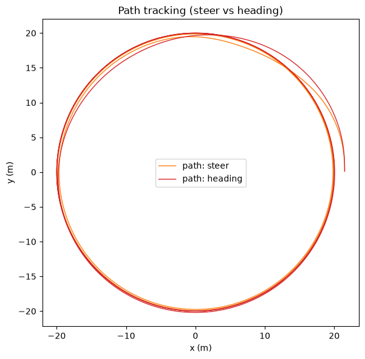
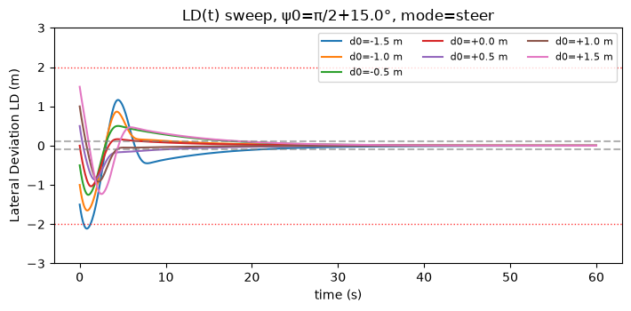

# Fuzzy steering control for a vehicle in a roundabout

A Mamdani fuzzy controller that keeps a simulated car on the circular lane of a roundabout, with a comparison of two ways of measuring the angle error (**Steer** and **Heading**) and a test of how far the controller can be pushed.


This was the semester project of the course *Neuro-Fuzzy Control and Applications* (coursework, September 2025). Author: Konstantinos Vaios Chronis.

<p align="center"></p>

## Results at a glance

| Quantity | Value |
|---|---|
| Controller | Mamdani, 3 inputs (LD, angle error, LD rate), 1 output (steering correction), 11 rules, centroid defuzzification |
| Radius sweep, R = 12.5 to 30 m (start 1.5 m outside the lane centre) | every run converges; final steering angle within 0.02° of the ideal angle atan(L/R) |
| Steer vs Heading (R = 20 m, same start) | Steer: RMS deviation 0.331 m, steering correction up to 4.6°. Heading: 0.427 m, up to 1.4° |
| What makes the two modes differ | the output gain (1.0 vs 0.25), not the angle signal: with equal gains they give almost the same result (0.335 m vs 0.331 m) |
| Initial heading error of +15° (toward the centre), R = 15 m | all 14 runs converge; the car leaves the 4 m lane for a moment in 1 of 7 Steer runs and 3 of 7 Heading runs |
| Initial heading error of −15° (outward) | the car leaves the lane in 5 of 7 Steer runs and 7 of 7 Heading runs (up to 4.37 m from the centre line) |

## Contents

- [The task](#the-task)
- [What I did](#what-i-did)
- [Results](#results)
- [Repository structure](#repository-structure)
- [Getting started](#getting-started)
- [References](#references)
- [Sources and credits](#sources-and-credits)
- [License](#license)

## The task

This summary is in English; the original statement is in Greek and is not included here.

Design a fuzzy steering controller that drives an autonomous car around a roundabout, keeping it on a circle of radius R, in the spirit of the controllers of Pérez Rastelli and Santos Peñas (2015). Simulate the closed loop, test it from different starting states and radii, and discuss how such a controller would be used on a real car.

## What I did

**Vehicle model.** The car is a bicycle model driving counter-clockwise at a constant 6 m/s (wheelbase L = 2.8 m), simulated with a time step of 0.02 s:

```
psi += (v / L) * tan(delta) * dt        then        x += v * cos(psi) * dt,   y += v * sin(psi) * dt
```

The wheels do not turn instantly: a first-order actuator with time constant 0.25 s follows the command, and the steering angle is limited to ±18°.

**Controller.** The fuzzy controller does not set the steering angle directly. It adds a **steering correction** SC to the ideal angle for the current radius:

```
delta_cmd = delta_ideal + gain * SC          delta_ideal = atan(L / R)
```

| Input | Meaning |
|---|---|
| **LD** (m) | Lateral deviation from the target circle, r − R (positive outside) |
| **ANG** (deg) | Angle error. **Steer** mode: `delta_actual - delta_ideal`. **Heading** mode: `psi - psi_ref`, with `psi_ref = atan2(y, x) + pi/2` tangent to the circle (positive means the car points toward the centre) |
| **LD rate** (m/s) | How fast the deviation grows (positive outward) |

Each input has three fuzzy sets and the output SC (±8°) has five. The 11 rules say, for example, "if the car is outside the circle and still moving outward, steer hard to the left". The fuzzy output is multiplied by a gain of 1.0 in Steer mode and 0.25 in Heading mode. If no rule fires for some input, the code applies no correction and counts it; this never happened in the runs below.


**Tests.** All runs last 60 s and start with the wheels straight (δ = 0), not at the ideal angle.

1. Radii R = 12.5, 15, 20 and 30 m, starting 1.5 m outside the circle and pointing along it.
2. Steer vs Heading from the same start (R = 20 m), and the same comparison with the two gains swapped.
3. At R = 15 m: seven starting offsets from −1.5 m to +1.5 m combined with an initial heading error of +10°, +15°, +18° (toward the centre) or −15° (outward). The lane is 4 m wide, so |LD| > 2 m means the car has left it.

## Results

All numbers and plots come from the notebook (`notebooks/fuzzy_roundabout_heading_vs_steer.ipynb`) and are printed there.

**Radius sweep** (Steer mode, start 1.5 m outside the circle, 60 s; Max |LD| is the starting offset):

| R (m) | RMS \|LD\| (m) | Max \|LD\| (m) | final steering angle (deg) | ideal angle (deg) | inside ±0.1 m after |
|---|---|---|---|---|---|
| 12.5 | 0.297 | 1.577 | 12.626 | 12.626 | 7.4 s |
| 15.0 | 0.297 | 1.558 | 10.574 | 10.574 | 12.2 s |
| 20.0 | 0.331 | 1.538 | 7.975 | 7.970 | 29.4 s |
| 30.0 | 0.368 | 1.516 | 5.350 | 5.332 | not within 60 s |

The car always ends on the circle with the ideal steering angle. At large radii the last part of the approach is slow: at R = 30 m, LD is still −0.10 m after 60 s.

**Steer vs Heading** from the same start (R = 20 m):



| Run | RMS \|LD\| (m) | lowest LD (m) | inside ±0.1 m after | largest correction \|SC\| (deg) |
|---|---|---|---|---|
| Steer, gain 1.0 (default) | 0.331 | −0.739 | 29.4 s | 4.64 |
| Heading, gain 0.25 (default) | 0.427 | −0.966 | 19.7 s | 1.42 |
| Steer, gain 0.25 | 0.425 | −0.960 | 19.6 s | 1.42 |
| Heading, gain 1.0 | 0.335 | −0.751 | 30.0 s | 4.76 |
| Steer, gain 1.0, angle input switched off | 0.337 | −0.751 | 30.0 s | 4.84 |

Steer mode corrects harder at first (up to 4.6° against 1.4°) and keeps the deviation smaller, but its last few centimetres take longer. Heading mode overshoots more and oscillates longer. Swapping the gains swaps the behaviour almost exactly, and switching the angle input off in Steer mode changes almost nothing. So the difference between the two modes comes from the output gain, not from the angle error they use. In Steer mode the angle error is essentially the correction the controller itself applied a moment earlier (delayed by the actuator), so it carries little information about the car's direction.

**Initial heading error** (R = 15 m, offsets from −1.5 m to +1.5 m). The red dotted lines are the lane edges at ±2 m:




| Initial heading error | Steer: runs that left the lane | Heading: runs that left the lane | Largest \|LD\| (Steer / Heading) | Settled to ±0.1 m within (Steer / Heading) |
|---|---|---|---|---|
| +10° (toward the centre) | 0 of 7 | 0 of 7 | 1.76 / 1.89 m | 18 / 21 s |
| +15° | 1 of 7 | 3 of 7 | 2.11 / 2.52 m | 21 / 25 s |
| +18° | 1 of 7 | 7 of 7 | 2.40 / 3.02 m | 22 / 30 s |
| −15° (outward) | 5 of 7 | 7 of 7 | 2.97 / 4.37 m | 24 / 43 s |

Every run returns to the circle, so the controller is stable in all these tests. Up to +10° the car stays in its lane; from +15° on, and when it starts pointing outward, it leaves the lane for a moment, more often in Heading mode.

## Repository structure

```
fuzzy-roundabout-steering/
├── README.md
├── requirements.txt
├── notebooks/
│   └── fuzzy_roundabout_heading_vs_steer.ipynb   controller, simulation, all tests and plots
├── figures/                                      plots used in this README, made by the notebook
├── report/
│   └── fuzzy_roundabout_report_GR.pdf            full report in Greek
└── slides/
    └── fuzzy_roundabout_slides_GR.pptx           presentation in Greek
```

## Getting started

Open the notebook in Google Colab, or locally:

```bash
pip install -r requirements.txt
jupyter notebook notebooks/fuzzy_roundabout_heading_vs_steer.ipynb
```

Run all cells (about 30 to 40 minutes on a laptop, mostly the 56 runs of the heading-error sweep). Set `ERROR_MODE = 'steer'` or `'heading'` at the top of the controller cell to change the default mode.

## References

- J. Pérez Rastelli and M. Santos Peñas, "Fuzzy logic steering control of autonomous vehicles inside roundabouts," *Applied Soft Computing* 35 (2015) 662-669.
- E. H. Mamdani and S. Assilian, "An experiment in linguistic synthesis with a fuzzy logic controller," *International Journal of Man-Machine Studies* 7(1), 1975, 1-13.
- R. Rajamani, *Vehicle Dynamics and Control*, 2nd ed., Springer, 2012 (kinematic bicycle model).

## Sources and credits

- **Assignment.** The task is the semester project of the course *Neuro-Fuzzy Control and Applications* (2025). The problem statement belongs to the course and is not included here. This README only summarizes it.
- **Paper.** The project is based on the paper by Pérez Rastelli and Santos Peñas listed above. The paper itself is not included here.
- **Related code.** While working on this project I found a similar implementation of the paper's controllers on GitHub: [BernardTockmaji/Fuzzy_logic_steering_control_of_autonomous_vehicles_inside_roundabouts](https://github.com/BernardTockmaji/Fuzzy_logic_steering_control_of_autonomous_vehicles_inside_roundabouts). That repository has no license, so none of its files are included here. The notebook in this repository is a separate implementation with three inputs (LD, angle error, LD rate) and one output (SC), and it adds the Steer/Heading comparison and the simulation tests.
- **Own work.** The controller design, the simulation code, the tests, the figures, the report and the slides are the author's own work for this project. The logo on the report's title page belongs to the university where the course was taught.
- **Libraries.** [scikit-fuzzy](https://github.com/scikit-fuzzy/scikit-fuzzy), [NumPy](https://numpy.org/) and [Matplotlib](https://matplotlib.org/).

## License

None. This work is shared for viewing only, and all rights are reserved by the author.
