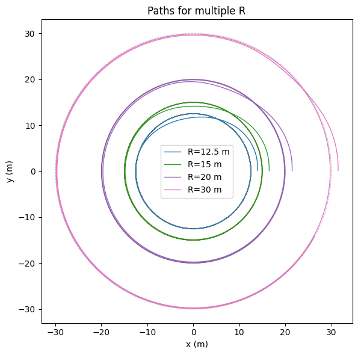
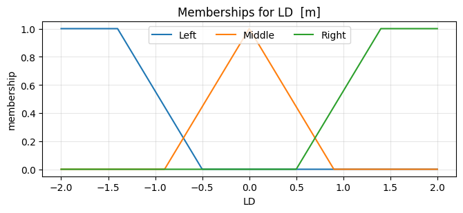
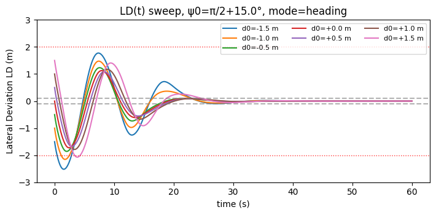

# Fuzzy steering control for a vehicle in a roundabout

A fuzzy-logic controller that keeps a car on the circular lane of a roundabout, with a simulation and a comparison of two ways of measuring the angle error (**Steer** and **Heading**).

Semester project 1 of *Neuro-fuzzy control and applications*, School of Electrical and Computer Engineering, NTUA (September 2025). Author: Konstantinos Vaios Chronis.



## What it does

The controller is a Mamdani fuzzy system built with [scikit-fuzzy](https://github.com/scikit-fuzzy/scikit-fuzzy). It does not set the steering angle directly. It adds a **steering correction** to the ideal angle for the current radius:

```
delta_cmd = delta_ideal + SC          delta_ideal = atan(L / R)   (bicycle model)
```

| Input | Meaning |
|---|---|
| **LD** (m) | Lateral deviation from the target circle |
| **ANG** (deg) | Angle error. In `steer` mode: wheel-position error `delta_actual - delta_ideal`. In `heading` mode: `psi - psi_ref`, with `psi_ref` tangent to the circle |
| **LD rate** (m/s) | How fast the deviation grows or shrinks (outward or inward) |

The output is the steering correction **SC** (deg). A vehicle simulation based on the bicycle model closes the loop. Switch between the two modes with `ERROR_MODE = 'steer'` or `'heading'` at the top of the notebook.



## Results

All numbers and plots below are the outputs saved in the notebook (`notebooks/fuzzy_roundabout_heading_vs_steer.ipynb`).

**Sweep over the roundabout radius** (steer mode, default start; printed by the notebook):

| R (m) | RMS \|LD\| (m) | Max \|LD\| (m) | final steering angle (deg) | ideal angle (deg) |
|---|---|---|---|---|
| 12.5 | 0.297 | 1.576 | 12.626 | 12.626 |
| 15.0 | 0.297 | 1.558 | 10.574 | 10.574 |
| 20.0 | 0.331 | 1.538 | 7.975 | 7.970 |
| 30.0 | 0.367 | 1.516 | 5.350 | 5.332 |

In every case the final steering angle matches the ideal angle for that radius.

**Steer vs Heading** from the same starting state:


**Lateral deviation over time** for starting offsets from -1.5 m to +1.5 m (R = 15 m, initial heading error of 15 degrees). In these runs both modes settle inside the +-0.1 m band after roughly 30 s, and the steer mode overshoots less than the heading mode.




## Run it

Open the notebook in Google Colab, or locally:

```bash
pip install -r requirements.txt
jupyter notebook notebooks/fuzzy_roundabout_heading_vs_steer.ipynb
```

Run all cells. The first cell installs `scikit-fuzzy`.

## Repository contents

```
notebooks/
  fuzzy_roundabout_heading_vs_steer.ipynb   controller, simulation and plots
report/   full written report (Greek)
slides/   presentation (Greek)
figures/  plots used in this README, taken from the notebook outputs
```

The report and slides are in Greek, as submitted for the course.

## Sources and credits

- **Paper.** This project is based on J. Pérez Rastelli and M. Santos Peñas, "Fuzzy logic steering control of autonomous vehicles inside roundabouts," *Applied Soft Computing* 35 (2015) 662-669 (Elsevier). The paper itself is not included here.
- **Related code.** While working on this project I found a similar implementation of the paper's controllers on GitHub: [BernardTockmaji/Fuzzy_logic_steering_control_of_autonomous_vehicles_inside_roundabouts](https://github.com/BernardTockmaji/Fuzzy_logic_steering_control_of_autonomous_vehicles_inside_roundabouts). That repository has no license, so none of its files are included here. The notebooks in this repository are a separate implementation: the controller has three inputs (LD, angle error, LD rate) and one output (SC), and they add the Steer/Heading comparison and the simulation sweeps.
- **Library.** [scikit-fuzzy](https://github.com/scikit-fuzzy/scikit-fuzzy), [NumPy](https://numpy.org/) and [Matplotlib](https://matplotlib.org/).

## License

None. This work is shared for viewing only, and all rights are reserved by the author.
